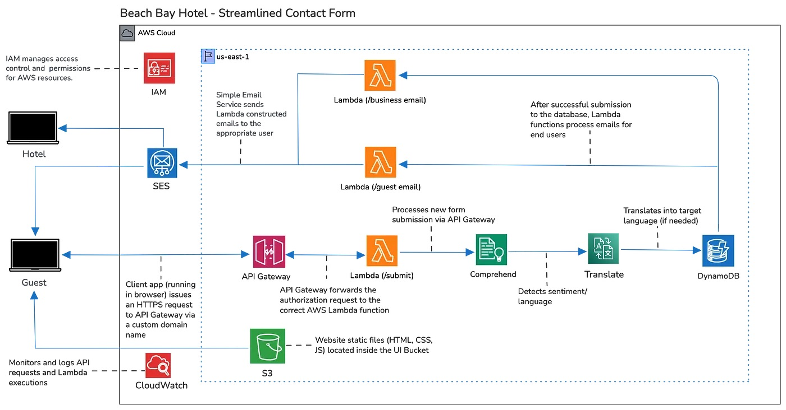

# Serverless AI Contact Form for Hospitality (AWS + Terraform)

An AWS serverless contact form that processes hospitality guest inquiries, detects language and sentiment, translates messages, stores submissions, and sends email notifications. Terraform defines the supporting infrastructure.

**Focus:** AWS infrastructure as code, serverless integration, IAM, and secure static-site delivery.

[Architecture deep dive (Medium)](https://medium.com/@psalvador8/building-a-serverless-ai-contact-form-with-aws-and-terraform-enhancing-guest-communication-at-aeae50b4d354)

## Business problem and solution

Hospitality teams may receive inquiries in multiple languages and need a consistent way to capture and route messages. This project models a guest inquiry workflow using managed AWS services rather than manually processing every submission.

The application is a portfolio implementation, not a claim of production use or measured business outcomes.

## Architecture



**Frontend:** Static HTML, CSS, and JavaScript in a **private S3 bucket**, delivered through **CloudFront with Origin Access Control (OAC)**. S3 Block Public Access is enabled; the bucket is not a public S3 website endpoint.

**Request path:**

```text
Guest browser -> CloudFront -> private S3 (frontend)
Guest browser -> API Gateway HTTP API (POST /contact)
              -> Lambda (Node.js)
                 -> Comprehend (language and sentiment)
                 -> Translate (non-English messages)
                 -> DynamoDB (inquiry record)
                 -> SES (staff email notification)
```

Terraform provisions the S3 bucket, CloudFront distribution and OAC, HTTP API, Lambda function and permissions, DynamoDB table, IAM configuration, and related resources. The browser calls API Gateway directly; CloudFront serves the static frontend.

## Technologies

- **Infrastructure:** Terraform, Amazon S3, Amazon CloudFront, OAC, IAM
- **Backend:** Amazon API Gateway (HTTP API), AWS Lambda (Node.js), Amazon DynamoDB, Amazon SES
- **Language processing:** Amazon Comprehend and Amazon Translate
- **Frontend:** HTML, CSS, JavaScript

## Key engineering decisions

- **Private S3 origin:** CloudFront OAC grants the distribution read access without making the bucket public.
- **Infrastructure as code:** Terraform keeps resource configuration reviewable and reproducible.
- **Managed serverless services:** API Gateway, Lambda, and DynamoDB reduce server administration.
- **Scoped AWS access:** IAM roles and policies govern Lambda access to dependent services.
- **Separated frontend and backend:** Static assets are delivered by CloudFront; form submissions use an HTTP API.

These are architectural choices represented in the repository, not proof that the latest configuration has passed a full deployment test.

## Deploying the project

> **Status:** The current Terraform configuration has not been independently end-to-end deployment-tested as part of the latest repository review. Review configuration, account permissions, costs, and AWS service availability before deployment.

### Prerequisites

- AWS account and configured AWS CLI credentials with appropriate permissions
- Terraform and Node.js/npm installed; `zip` available
- A globally unique S3 bucket name for the frontend
- An existing **Terraform state S3 bucket**: `infrastructure/backend.tf` currently specifies `beachbay-tf-state-miami` in `us-east-1`. **Change that backend bucket to one you own and create it before `terraform init`.** Protect state and configure locking appropriately.
- SES sender and notification addresses appropriate to your AWS account and SES verification/sandbox status

### 1. Package Lambda dependencies

From the repository root:

```bash
./package_lambda.sh
```

This runs `npm ci` and builds `lambda/package.zip`, which Terraform expects to exist before planning.

### 2. Configure Terraform variables

```bash
cd infrastructure
cp terraform.tfvars.example terraform.tfvars
```

Edit `terraform.tfvars` with your own globally unique `website_bucket_name`, verified `ses_sender_email`, and `ses_notify_email`. Review the region and resource names. Do not commit personal values, credentials, state files, or secrets.

### 3. Initialize and review

After configuring the backend S3 bucket:

```bash
terraform init
terraform fmt -check
terraform validate
terraform plan
```

Inspect the plan, expected permissions, resource costs, and names before applying.

### 4. Provision resources

```bash
terraform apply
terraform output
```

Relevant outputs include `bucket_name`, `website_endpoint` (CloudFront HTTPS URL), and `http_api_endpoint` (API Gateway base URL).

### 5. Configure and upload the frontend

Replace `REPLACE_WITH_API_GATEWAY_ENDPOINT` in `frontend/script.js` with the `http_api_endpoint` output, preserving the existing `/contact` suffix.

Upload the files in `frontend/` to the **private** S3 bucket shown by `bucket_name` (for example, using `aws s3 sync ../frontend/ s3://YOUR_BUCKET_NAME/` while in `infrastructure/`). Access the site through `website_endpoint`, **not** an S3 website URL.

If updating an existing CloudFront deployment, allow for cache propagation or invalidate cached assets as needed.

### 6. Verify behavior

Recommended manual checks after deployment:

1. Load the frontend over HTTPS using the CloudFront URL.
2. Submit an inquiry and inspect the browser response.
3. Confirm a DynamoDB record is created and an SES notification is delivered.
4. Submit a non-English message and inspect translation/language handling.
5. Review Lambda logs and confirm the S3 bucket is not publicly accessible.

**These are suggested validation steps, not a claim that the current version passed them.**

### Cleanup

When finished, empty the website bucket if necessary and review the Terraform destroy plan before running `terraform destroy`. The separately created Terraform backend bucket and its state require separate lifecycle management. Check for any residual billable resources.

## Repository structure

```text
.
├── README.md
├── package_lambda.sh
├── infrastructure/
│   ├── api.tf
│   ├── backend.tf
│   ├── iam.tf
│   ├── lambda.tf
│   ├── main.tf
│   ├── outputs.tf
│   ├── variables.tf
│   └── terraform.tfvars.example
├── lambda/
│   ├── index.js
│   ├── package.json
│   └── package-lock.json
├── frontend/
│   ├── index.html
│   ├── script.js
│   └── styles.css
└── docs/
    └── architecture.jpeg
```

## Limitations and next steps

- The API's current CORS configuration allows all origins; production use would call for tighter origin restrictions and abuse protections.
- SES delivery depends on account verification and sandbox status.
- The deployment procedure requires manual packaging, frontend API URL configuration, and S3 upload.
- Add automated deployment validation, monitoring/alerting, and documented end-to-end test results before describing this as production-ready.

## Author

Priscilla Salvador — AWS Cloud Infrastructure & Terraform
